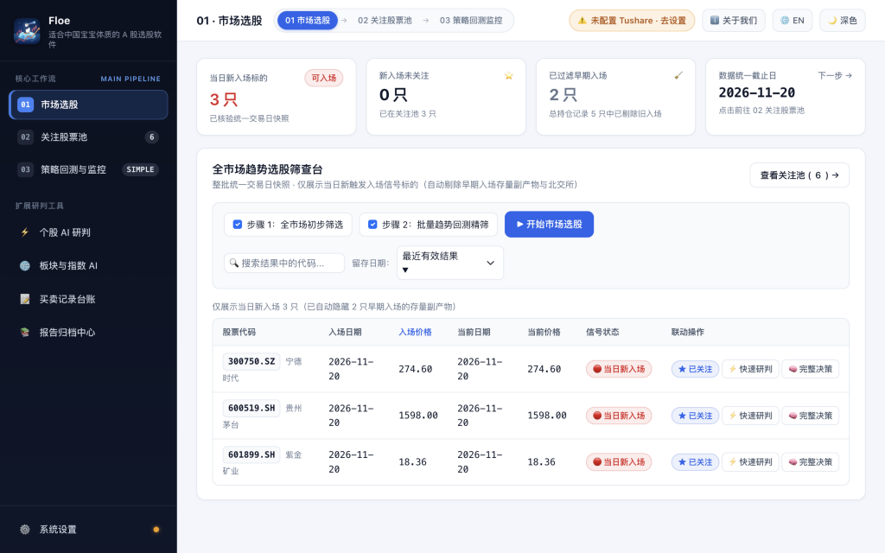
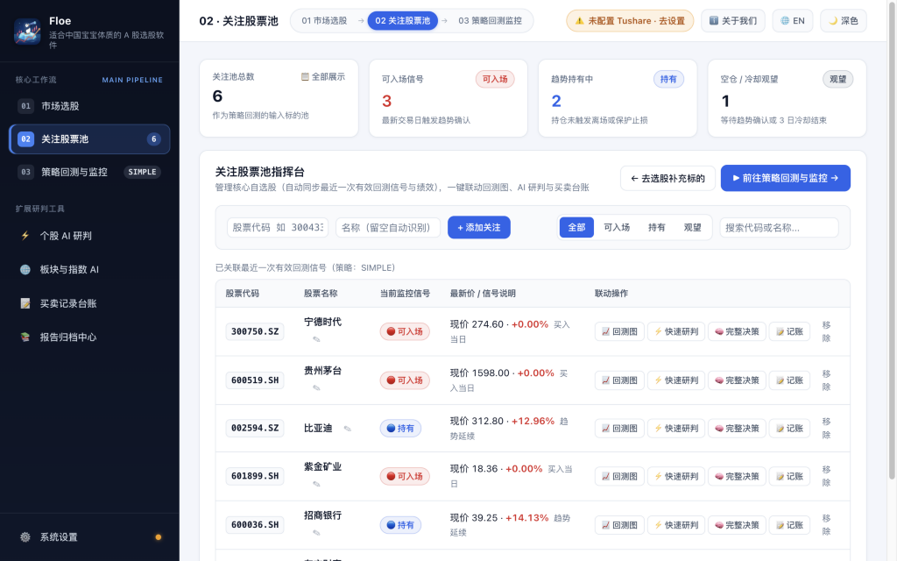
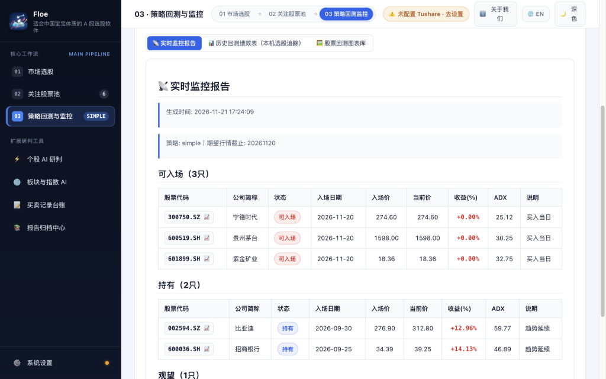
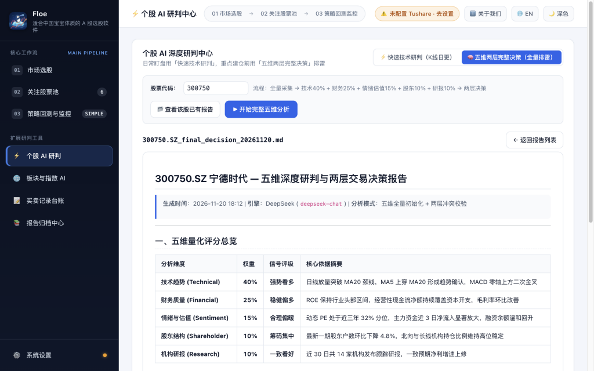
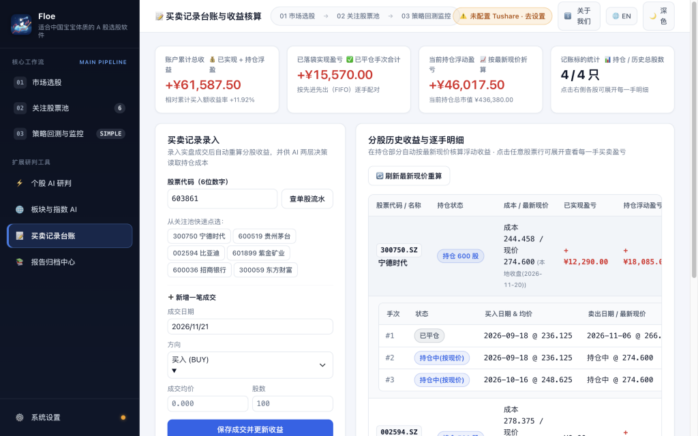
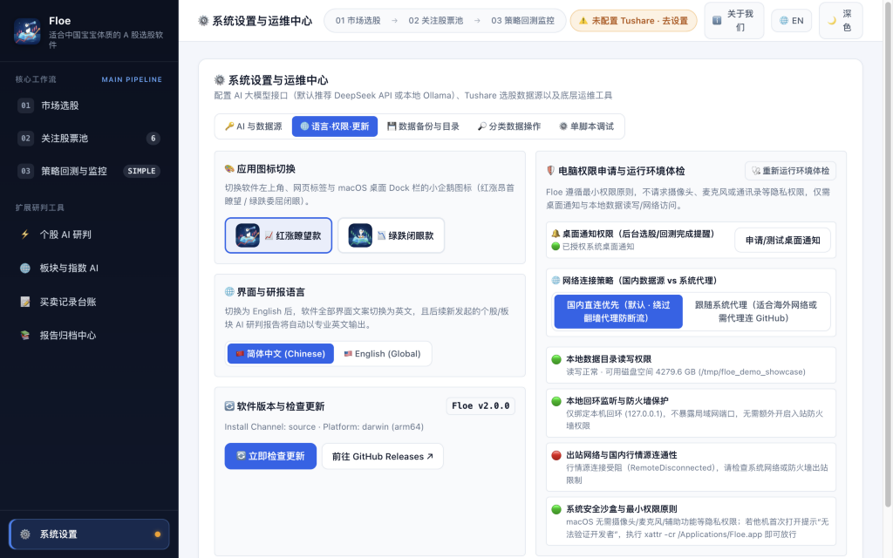
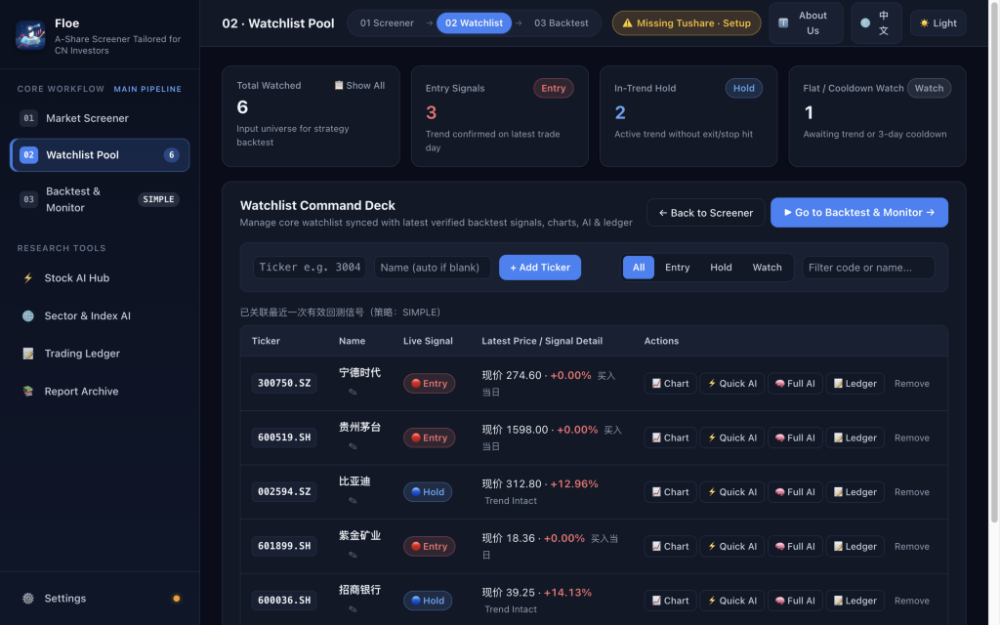
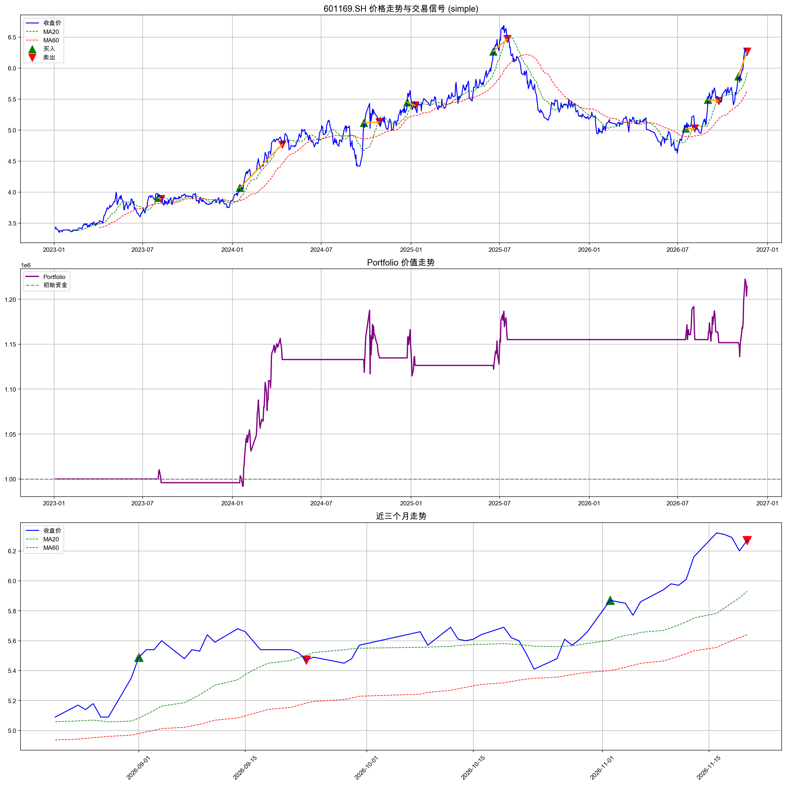

<p align="center">
  
  &nbsp;&nbsp;&nbsp;
  
</p>

<h1 align="center">Floe (formerly GP_ANA)</h1>

<p align="center">
  <b>A-Share Screener & Multi-Dimensional AI Quantitative Workbench Tailored for CN Investors</b><br>
  <sub>Version: <b>v2.0.1</b> ｜ <a href="README.md">简体中文</a> · <b>English</b></sub>
</p>

<p align="center">
  
  
  
  
  
  
</p>

---

## 📖 Overview

**Floe** (formerly **GP_ANA**) is a cross-platform **China A-Share quantitative screening, trend backtesting, and multi-dimensional AI investment research workbench** that runs directly on your own computer.

It automatically collects and cryptographically verifies scattered market evidence—full-market daily screening, forward-adjusted OHLCV, financial statements, main fund flows, margin trading, shareholder concentration, and institutional research reports—and feeds structured summaries into either **Cloud LLM APIs (DeepSeek / any OpenAI-compatible provider)** or **local Ollama models** to produce conflict-checked, position-aware trading plans.

> **🚀 Ready to use out of the box?** Jump straight to **[Quick Installation (Desktop / Homebrew / npm)](#-quick-installation-choose-any-method)** — zero Python or TA-Lib setup required.
>
> **🛠️ Building or customizing from source?** Jump to **[Method D: Full Source Deployment](#method-d-full-source-deployment-for-developers--custom-strategies)**.
>
> **📐 Deep dive into architecture & algorithms?** Read **[Introduction.md](Introduction.md)** (Chinese technical reference covering 5D weights, 2-layer conflict reasoning, snapshot isolation, artifact provenance, and REST APIs).

---

## ✨ Key Highlights in v2.0.0

### 1️⃣ Streamlined 3-Step Quantitative Pipeline: Screener → Watchlist → Backtest

```
01 Market Screener               02 Watchlist Pool                 03 Strategy Backtest & Monitor
──────────────────────           ──────────────────────            ──────────────────────────────
5,000+ A-share Tushare scan ──▶  Curate core watch universe  ──▶   Default Simple (MA5 > MA20)
Unified trade-date snapshot      Synced live signal badges         Symmetric entry/exit + 3d cooldown
New-entry-only filtering         Inline rename & 1-click jump      Local cohort performance tracker
```

- **Signal-First Market Screener (`01`)**: Freezes a single verified trade date across the entire batch and strictly displays **new entries triggered on that exact trade date** (`Entry Date == Data As-Of`), automatically filtering out older carry-over holdings and Beijing Stock Exchange (`.BJ`) tickers while archiving every successful batch under `selection_history/<YYYYMMDD>/`.
- **Practical Default Backtest & Cohort Tracking (`03`)**: Defaults to the responsive **Simple Trend Preset (`MA5 > MA20`)** with one-click switching to the strict 4-MA Full Preset, 3-trading-day post-exit cooldown, and a new **Tracked Selection Cohort Performance** table measuring cumulative returns from the exact day each stock was first discovered on your machine.

### 2️⃣ 5-Dimension Research + 2-Layer Conflict-Aware AI Decision Engine

Instead of dumping tens of thousands of raw words into an LLM, Floe distills five dimensions into structured JSON verdicts first:

| Dimension | Default Weight | Key Questions Answered |
|:---|--:|:---|
| 📈 **Technical Trend** | **40%** | Is an uptrend confirmed? Overbought/oversold? Where are key support/resistance levels? |
| 💰 **Financial Quality** | 25% | Are earnings backed by operating cash flow? Are ROE, margins, and leverage healthy? |
| 🌡️ **Sentiment & Valuation** | 15% | Is smart money flowing in or out? Where do PE/PB sit historically? |
| 🏢 **Shareholder Structure** | 10% | Is shareholder count concentrating? Are institutions & northbound funds accumulating? |
| 📰 **Research Consensus** | 10% | How are analyst ratings and earnings forecasts trending over the past quarter? |

- **Layer 1 (Hedge Fund Risk Manager)**: Isolates **contradictions** across the 5 dimensions (e.g., bullish technical breakout vs. deteriorating cash flow) and identifies key invalidation metrics.
- **Layer 2 (Trading Coach)**: Combines Layer 1's verdict with your **real FIFO cost basis and unrealized P&L** to output concrete *"If X happens, execute Y"* price action plans—never vague boilerplate.

### 3️⃣ Cloud API (DeepSeek / OpenAI-Compatible) + Local Ollama Dual Engine

- **Zero GPU Requirement (Recommended)**: Configure **DeepSeek**, SiliconFlow, Qwen, Moonshot, or any OpenAI-compatible endpoint directly in **Settings → AI & Data Sources**. A mandatory **2-step live verification** (*1. Connect & Fetch Models* → *2. Save AI Settings*) ensures your key and model ID work before running any task.
- **100% Local Inference**: Prefer offline LLM execution? Switch seamlessly to local **Ollama** (`http://localhost:11434`) at any time.

### 4️⃣ 3-Decimal (`0.001` CNY) FIFO Trading Ledger

- Supports **sub-cent 3-decimal fill prices** (e.g. `15.825` CNY) required for A-share ETFs, convertible bonds, and low-priced stocks.
- Automatically matches historical buys and sells via **FIFO (First-In, First-Out)**, displaying Account Total Net P&L, Realized Profit, and Live Unrealized P&L (marked to EastMoney real-time quotes with local QFQ fallback), plus expandable lot-by-lot breakdowns.

### 5️⃣ Native Desktop App, Bilingual UI & Dual Penguin Icons

- **Lightweight Native Window**: Built on `pywebview` (system WebKit / WebView2 / WebKitGTK—no bloated Chromium bundle), complete with a monochrome penguin macOS menu-bar icon and Windows/Linux system tray.
- **Dual App Icons**: Switch anytime in Settings between **📈 Bullish Lookout Penguin** and **📉 Bearish Eyes-Closed Penguin** (updates sidebar, browser favicon, and macOS Dock icon live).
- **Full Chinese / English UI & English AI Reports**: Switching to `English` translates the entire workbench *and* instructs the LLM to generate all subsequent stock and sector research reports in professional English.
- **Auto Port Fallback & 1-Click Backup**: Binds safely to `127.0.0.1:3130` (`debug=False`) and automatically falls back to `3131+` if occupied; includes AST-validated `.zip` backup export/import.

---

## 🖥️ Screenshots (Floe v2.0.0 Live Showcase)

> Captured from an isolated demo workspace populated with synthetic public blue-chip data.

### 01 Market Screener & 02 Watchlist Command Deck
<p align="center">
  
  
</p>

### 03 Strategy Backtest Live Monitor & 5D Two-Layer AI Research Hub
<p align="center">
  
  
</p>

### 3-Decimal FIFO Trading Ledger & Settings (Dual Penguin Icons · Diagnostics)
<p align="center">
  
  
</p>

### Dark + English Workbench Mode & Strategy Backtest Signal Chart
<p align="center">
  
  
</p>

---

## 🚀 Quick Installation (Choose Any Method)

### Method A: Standalone Desktop Installer (Zero Dependencies · Recommended)

Download the prebuilt bundle for your OS from **[GitHub Releases](https://github.com/Leo-luxy/Floe/releases)**—no Python or TA-Lib installation needed:

| OS | Package | First-Launch Notes |
|:---|:---|:---|
| **macOS** (Apple Silicon / Intel) | `Floe-v2.0.1-macos-*.dmg` | Drag `Floe.app` to `Applications`. If macOS Gatekeeper warns about an unverified developer on first launch, run once in Terminal:<br>`xattr -cr /Applications/Floe.app` |
| **Windows 10 / 11** (x64) | `Floe-v2.0.1-windows-x64.zip` | Extract and double-click `Floe.exe` |
| **Linux** (Ubuntu 22.04+ x64) | `Floe-v2.0.1-linux-x86_64.AppImage` | `chmod +x Floe-*.AppImage && ./Floe-*.AppImage` |

> 💾 **Upgrade-Safe User Data**: Packaged builds isolate all user settings, watchlists, trading ledgers, and market data under your OS standard app-data folder (`~/Library/Application Support/Floe` on macOS, `%APPDATA%\Floe` on Windows, `~/.local/share/floe` on Linux), so app upgrades never overwrite your data.

---

### Method B: Homebrew (macOS)

```bash
brew tap Leo-luxy/tap
brew install --cask floe
```

---

### Method C: npm Global CLI (Cross-Platform)

Requires Node.js `>= 18`:

```bash
npm install -g @leo-luxy/floe

# Launch native desktop window
floe

# Launch in browser-only mode
floe --web --port 3130

# Run environment & permission diagnostics
floe --doctor
```

---

### Method D: Full Source Deployment (For Developers & Custom Strategies)

#### Step 1: Clone Repository & Prepare Python 3.10 / 3.11

> Note: `numpy==1.26.3` supports Python **3.9 – 3.12** (Python 3.10 / 3.11 recommended).

```bash
git clone https://github.com/Leo-luxy/Floe.git
cd Floe

conda create -n floe python=3.10 -y
conda activate floe
```

#### Step 2: Install Native TA-Lib C Library

- **macOS**: `brew install ta-lib`
- **Ubuntu / Debian**:
  ```bash
  sudo apt-get update && sudo apt-get install -y build-essential wget
  wget https://github.com/ta-lib/ta-lib/releases/download/v0.6.4/ta-lib-0.6.4-src.tar.gz
  tar -xzf ta-lib-0.6.4-src.tar.gz && cd ta-lib-0.6.4
  ./configure --prefix=/usr && make && sudo make install && cd ..
  ```
- **Windows**: Download the matching `.whl` from [cgohlke/talib-build Releases](https://github.com/cgohlke/talib-build/releases) and `pip install` it.

#### Step 3: Install Python Dependencies & Launch

```bash
pip install -r requirements.txt

# Start Web Server (binds safely to http://127.0.0.1:3130, auto-falls back if busy)
python web_ui.py

# Or launch native desktop window (optional: pip install pywebview pystray)
python floe_app.py
```

On first launch, missing `config.py`, `data/`, and `log/` are initialized automatically. Open **`http://127.0.0.1:3130`** and configure your **DeepSeek / OpenAI API Key** (or local Ollama) and **Tushare Pro Token** (120+ points required for `01 Market Screener`) directly inside **⚙️ Settings → AI & Data Sources**.

---

## 🔒 Security & Privacy Architecture

1. **Loopback-Only Binding by Default**: `web_ui.py` and the desktop runtime bind strictly to `127.0.0.1:3130` with `debug=False`, preventing LAN exposure and disabling interactive debuggers.
2. **Git-Safe Local Credentials**: API keys, Tushare tokens, watchlists, and trading ledgers configured via the UI are stored locally outside Git tracking; `.zip` backup restores validate Python files via strict AST literal parsing (`ast.literal_eval`) with zero `exec` risk.
3. **Least-Privilege Footprint**: Floe never requests camera, microphone, contacts, location, or accessibility permissions.

---

## 📮 Feedback & Contact

Bug reports, feature ideas, and pull requests are warmly welcome:

- **📧 Maintainer Email**: **[luleo856@gmail.com](mailto:luleo856@gmail.com)**
- **🐙 GitHub Issues**: **[https://github.com/Leo-luxy/Floe/issues](https://github.com/Leo-luxy/Floe/issues)**

---

## 📄 Release History

| Version | Date | Highlights |
|:---|:---|:---|
| **v2.0.1** | 2026-11 | Fixed packaged desktop HTTPS certificate chain verification (bundled & auto-mounted `certifi` + OS CA roots); smart local proxy tunnel fallback for GitHub update checks & overseas APIs; Windows restricted-AppData portable fallback; 311 unit tests |
| **v2.0.0** | 2026-11 | **Rebranded to Floe**; modern 3-step workbench UI; cross-platform desktop app (macOS/Windows/Linux) + Homebrew & npm distribution; 2-step verified Cloud LLM API (DeepSeek/OpenAI) + Ollama dual engine; 3-decimal (`0.001`) FIFO trading ledger; tracked local selection performance; dual bull/bear penguin icons, Chinese/English UI & English AI reports, auto port fallback (`3130`), 1-click ZIP backup; 309 unit tests |
| **v1.6.0** | 2026-11 | Unified batch trade-date snapshot & daily archiving, cryptographic backtest/indicator provenance, observable degraded/void states, Tushare primary/backup token failover |
| **v1.5.0** | 2026-09 | Two-book documentation (`README` + `Introduction`), real-date report sorting, persistent task cache |
| **v1.4.0** | 2026-06 | Full-market screener + watchlist, standard 9-day EMA KDJ & sector freshness alignment |
| **v1.3.0** | 2026-06 | Sector & broad-index AI research module |
| **v1.2.0** | 2026-05 | 5-dimension `Process/` engine, 2-layer conflict decision architecture, quick analysis & trend backtester |
| **v1.1.0** | 2026-03 | Initial Flask Web UI, 12 collectors, 5 analyzers |
| **v1.0.1** | 2026-02 | Initial data collection & technical analysis scripts |

See **[CHANGELOG.md](CHANGELOG.md)** for full release notes.

---

## 📜 License & Disclaimer

Licensed under the **[MIT License](LICENSE)**.

**⚖️ Disclaimer**: Floe is a software tool for quantitative research and technical learning only. Nothing generated by this software—including stock screening lists, backtest metrics, AI research reports, or trading plans—constitutes financial or investment advice. Investing in equity markets involves substantial risk; users assume full responsibility for their own investment decisions.

<p align="center">
  <sub>Made with ❤️ for A-Share quantitative investors · <b>Floe v2.0.1</b></sub>
</p>
